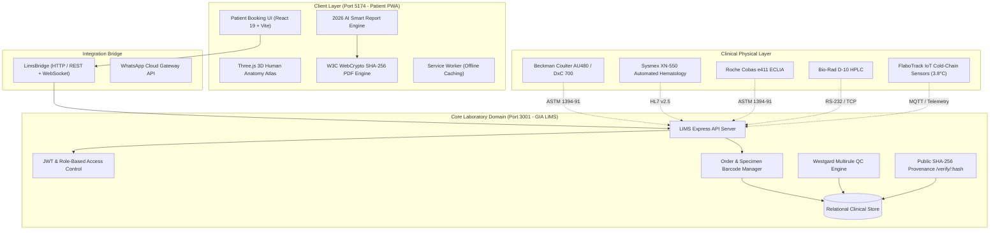

# System Architecture Specification (ARCHITECTURE.md)
**Product**: Dr. Shastri Diagnostics (DSD Care) Aligarh PWA & GIA LIMS  
**Architecture**: Decoupled Micro-Frontend PWA + Node.js LIMS Core  
**Standard**: 21 CFR Part 11 / ISO 15189:2022 / SLSA Level-3 Supply Chain  
**Status**: APPROVED & ACTIVE  

---

## 1. High-Level System Architecture

The Dr. Shastri Diagnostics ecosystem consists of two primary decoupled, zero-coupling runtime domains:
1. **Patient Booking & Clinical Diagnostic PWA (`01_DSD_Patient_Booking`)**: Client-side progressive web application served via Vite preview/production daemon on port `5174`.
2. **GIA LIMS Core Laboratory Engine (`03_GIA_LIMS_Core`)**: Enterprise clinical laboratory information management server running on port `3001`.



---

## 2. Technology Stack & Rationale

| Layer | Technology | Version | Architectural Rationale |
| :--- | :--- | :--- | :--- |
| **Frontend Framework** | React | `19.0.0` | Concurrent rendering, zero bundle bloat, native form actions |
| **Language** | TypeScript | `5.7.0` | Strict type-safety, zero implicit `any`, build-time validation |
| **Build Tool** | Vite | `6.4.5` | Sub-second HMR, tree-shaking, production Rollup bundling |
| **3D Graphics Engine** | Three.js | `0.186.1` | Hardware-accelerated WebGL2 rendering of anatomical models |
| **Animation Physics** | Framer Motion | `14.6.0` | Spring physics on organ resonance and interactive drawers |
| **Icons & Visuals** | Lucide React | `0.469.0` | Clean SVG tree-shakeable iconography |
| **Styling** | Tailwind CSS | `3.4.0` | Predictable utility classes, zero runtime CSS overhead |
| **Cryptography** | W3C WebCrypto API | Native | Native browser FIPS 180-4 SHA-256 calculation (`window.crypto.subtle`) |
| **LIMS Backend** | Node.js / Express | `20.x` LTS | High throughput I/O, event-driven analyzer communication |
| **Security Inspector** | Python / Pytest | `3.11+` | Automated forensic break-testing, HIPAA vulnerability scanning |

---

## 3. Cryptographic Provenance Architecture

To eliminate medical report fraud and comply with **21 CFR Part 11**:
1. **Deterministic Input Canonicalization**:
   ```
   Payload = "{bookingId}:{patientName}:{barcode}:{reportedTimestamp}:{sortedParameters}"
   ```
2. **Hardware-Accelerated Hashing**:
   Calculated using `crypto.subtle.digest('SHA-256', data)` produces a 64-character hexadecimal digest.
3. **Dual Verification Vectors**:
   - Stamped on the official NABL PDF letterhead.
   - Embedded in a high-density QR code linking to `http://127.0.0.1:3001/verify/VER-{bookingId}`.
   - Anyone scanning the QR code accesses the immutable audit record stored in the LIMS ledger.

---

## 4. Cold-Chain IoT Architecture (FlaboTrack™)

- **Hardware**: Insulated digital sample transport box with embedded DS18B20 digital temperature probe and GPS transmitter.
- **Operating Threshold**: Strictly constrained to **2.0°C to 8.0°C** (Nominal target: **3.8°C**).
- **Alarm Matrix**: If internal transit temperature exceeds 8.0°C for > 5 continuous minutes, an automated cold-chain breach event is logged in LIMS, invalidating LD, SGOT, and electrolyte tests.
- **Security Checkpoint**: Dual verification requiring phlebotomist entry of the patient's private 4-digit Collection OTP (`8492`) before sample sealing.

---

## 5. Security & Isolation Boundaries

- **Zero Client-Side Secrets**: No database credentials, SMS gateway keys, or private pathologist keys are exposed in the client-side JavaScript bundle.
- **CORS Policy**: GIA LIMS Core explicitly whitelists `http://localhost:5174` and `http://127.0.0.1:5174`.
- **PHI Scrubbing**: URLs never contain patient names, phone numbers, or diagnostic test codes in plain text.
- **Role-Based Workspaces**:
  - `patient`: Restricted to booking and viewing verified released reports.
  - `phlebo`: Restricted to assigned collection route and OTP entry.
  - `sales`: Restricted to doctor visit logging and referral reports.
  - `admin` / `pathologist`: Authorized for analyzer result entry, Westgard QC, and digital sign-off.
  - `superadmin`: Global multi-tenant configuration and tenant isolation.
