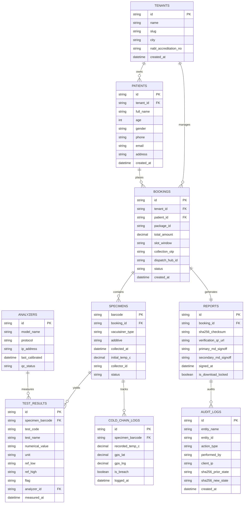

# Database Architecture & Relational Schema (DATABASE.md)
**Product**: Dr. Shastri Diagnostics (DSD Care) Aligarh PWA & GIA LIMS  
**Compliance**: 21 CFR Part 11 Electronic Records / HIPAA Security Rule / Multi-Tenant RLS  
**Status**: APPROVED & ACTIVE  

---

## 1. Database Philosophy & Design Principles

The clinical database powering Dr. Shastri Diagnostics and the GIA LIMS Core is designed for **absolute data integrity, immutable auditability, and zero data leakage**:
1. **Append-Only Clinical Audit Trail**: Result modifications or sign-offs cannot overwrite prior entries; each change creates a cryptographically signed version.
2. **Strict Foreign Key Constraints**: Samples cannot be created without a parent booking; test results cannot be logged without an associated specimen barcode and analyzer identifier.
3. **Multi-Tenant Row-Level Security (RLS)**: Every clinical entity includes a `tenant_id` ensuring strict logical separation across partner diagnostic hubs.

---

## 2. Entity-Relationship (ER) Diagram

---

## 3. Data Dictionary & Table Schemas

### 3.1 `bookings`
| Column | Type | Constraints | Description |
| :--- | :--- | :--- | :--- |
| `id` | `VARCHAR(32)` | `PRIMARY KEY` | Unique identifier (e.g. `DSD-2401`) |
| `tenant_id` | `VARCHAR(32)` | `NOT NULL, FK` | Multi-tenant isolation key |
| `patient_id` | `VARCHAR(32)` | `NOT NULL, FK` | References `patients.id` |
| `package_id` | `VARCHAR(64)` | `NOT NULL` | Test package identifier (e.g. `smartadvance`) |
| `total_amount` | `DECIMAL(10,2)`| `NOT NULL` | Net booking total in INR |
| `slot_window` | `VARCHAR(64)` | `NOT NULL` | Morning collection window (e.g. `7:00–8:00 AM`) |
| `collection_otp` | `CHAR(4)` | `NOT NULL` | 4-digit doorstep authentication OTP (`8492`) |
| `dispatch_hub_id`| `VARCHAR(32)` | `NOT NULL` | Assigned Aligarh hub (`hub-ramghat`) |
| `status` | `VARCHAR(24)` | `NOT NULL` | `SCHEDULED`, `COLLECTED`, `TESTING`, `RELEASED` |

### 3.2 `specimens`
| Column | Type | Constraints | Description |
| :--- | :--- | :--- | :--- |
| `barcode` | `VARCHAR(32)` | `PRIMARY KEY` | Machine-readable barcode (`BC-DSD-98124`) |
| `booking_id` | `VARCHAR(32)` | `NOT NULL, FK` | References `bookings.id` |
| `vacutainer_type`| `VARCHAR(32)`| `NOT NULL` | `Lavender EDTA`, `Gold SST Gel`, `Grey Fluoride` |
| `collected_at` | `DATETIME` | `NOT NULL` | Exact collection timestamp |
| `initial_temp_c`| `DECIMAL(4,2)`| `NOT NULL` | Recorded temperature at patient home (target: 3.8°C) |
| `collector_id` | `VARCHAR(64)` | `NOT NULL` | Phlebotomist identifier (e.g. `Rahul Sharma`) |

### 3.3 `test_results`
| Column | Type | Constraints | Description |
| :--- | :--- | :--- | :--- |
| `id` | `VARCHAR(36)` | `PRIMARY KEY` | UUIDv4 |
| `specimen_barcode` | `VARCHAR(32)` | `NOT NULL, FK` | References `specimens.barcode` |
| `test_code` | `VARCHAR(16)` | `NOT NULL` | Standard LOINC / Lab test code (`FBS`, `HBA1C`) |
| `numerical_value` | `VARCHAR(16)` | `NOT NULL` | Measured clinical value (e.g. `108`) |
| `unit` | `VARCHAR(16)` | `NOT NULL` | Measurement unit (`mg/dL`, `U/L`, `%`) |
| `ref_low` | `DECIMAL(8,2)`| `NOT NULL` | Lower bound of biological reference interval |
| `ref_high` | `DECIMAL(8,2)`| `NOT NULL` | Upper bound of biological reference interval |
| `flag` | `VARCHAR(8)` | `NOT NULL` | `NORMAL`, `HIGH`, `LOW`, `CRITICAL` |
| `analyzer_id` | `VARCHAR(32)` | `NOT NULL, FK` | References `analyzers.id` (`BECKMAN_AU480`) |

### 3.4 `reports` (Cryptographic Provenance)
| Column | Type | Constraints | Description |
| :--- | :--- | :--- | :--- |
| `id` | `VARCHAR(32)` | `PRIMARY KEY` | Report reference (e.g. `REP-DSD-2401`) |
| `booking_id` | `VARCHAR(32)` | `NOT NULL, UNIQUE` | References `bookings.id` |
| `sha256_checksum` | `CHAR(64)` | `NOT NULL` | NIST FIPS 180-4 64-hex tamper-proof hash |
| `primary_md_signoff` | `VARCHAR(64)` | `NOT NULL` | `Dr. S. K. Shastri, MD (AIIMS)` |
| `secondary_md_signoff`| `VARCHAR(64)` | `NOT NULL` | `Dr. Ananya Shastri, MD` |
| `is_download_locked` | `BOOLEAN` | `DEFAULT TRUE` | Unlocked ONLY after dual MD sign-off |

---

## 4. 21 CFR Part 11 Audit Trail

All record creations, result updates, and verification events generate an append-only entry in `audit_logs`:
- Timestamp is captured in ISO 8601 UTC.
- User ID and Client IP are recorded.
- Cryptographic hash before and after the modification is persisted to detect retroactive database tampering.
