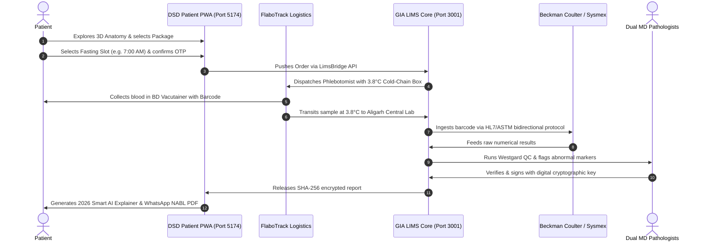

# Product Requirements Document (PRD)
**Product**: Dr. Shastri Diagnostics (DSD Care) Aligarh PWA & GIA LIMS Core  
**Version**: 2.0.0 (2026 Production Release)  
**Standard**: ISO 15189:2022 / HIPAA Security Rule / 21 CFR Part 11 / NABL Accredited  
**Status**: APPROVED & ACTIVE  

---

## 1. Executive Summary & Problem Statement

### 1.1 Problem
Patients in tier-2/3 Indian cities such as Aligarh face fragmented diagnostic experiences:
1. **Unreliable Pre-Analytical Protocols**: Lack of clear fasting instructions leading to inaccurate glucose and lipid readings.
2. **Cold-Chain Breaches**: Blood samples degraded during ambient summer transit (often exceeding 40°C), invalidating sensitive hepatic and cardiac enzyme results.
3. **Impenetrable Lab Reports**: Diagnostic sheets full of clinical jargon and numbers that patients cannot understand, leading to delayed medical interventions.
4. **Fraud & Tampering**: Paper and PDF lab reports lack cryptographic integrity, making verification difficult for consulting physicians.

### 1.2 Value Proposition & Solution
Dr. Shastri Diagnostics (DSD Care) provides a gold-standard, digitally verifiable diagnostic ecosystem:
- **Doorstep Cold-Chain Phlebotomy (FlaboTrack™)**: 60-minute arrival with 2°C–8°C digital temperature monitoring and dual-OTP sample pickup security.
- **Automated High-Throughput Analyzers**: 6-Sigma testing powered by Beckman Coulter AU, Sysmex XN-550, Bio-Rad D-10 HPLC, and Roche Cobas e411.
- **2026 Smart AI Visual Report**: Bilingual (Hindi/English) plain-language patient explainer with 5-zone bio-spectrum range tracks, personalized nutrition advice, and 60-second voice summaries.
- **SHA-256 Cryptographic Provenance**: Every NABL report is hashed via client-side W3C WebCrypto API and stamped with a tamper-proof verification QR code.

---

## 2. User Personas & Core Journeys

### 2.1 Personas
1. **Preventive Health Patient (e.g. Sunita Sharma, 52F)**: Needs routine wellness checkup, wants clear fasting instructions, same-day home sample collection, and an easy-to-understand report for her family physician.
2. **Field Phlebotomist (e.g. Rahul Sharma, FlaboTrack)**: Needs mobile routing, digital collection checklist, cold-chain temperature monitoring, and barcode scanning at the patient's doorstep.
3. **MD Pathologist (e.g. Dr. S. K. Shastri, AIIMS)**: Needs automated analyzer ingestion, Westgard QC rule validation, delta-checking against past results, and encrypted one-click digital signing.
4. **Consulting Physician**: Needs instant, tamper-proof QR verification of reports without login friction.

### 2.2 Core User Journey

---

## 3. Functional Requirements

### 3.1 Patient Booking PWA
- **Interactive 3D Human Anatomy Atlas**: WebGL-based anatomical model with focal resonance mapping for 14 major disease categories (Heart, Liver, Kidneys, Pancreas, Thyroid, Bone).
- **Pre-Analytical Metadata**: Dynamic badges displaying fasting hours (`10-12 Hrs Water Only`), sample container (`Lavender EDTA`, `Gold SST Gel`, `Grey Fluoride`), turnaround time (`Same Day within 6 Hrs`), and primary analyzer.
- **Fasting Slot Scheduling**: Tactile 2x2 morning slot selection (6-7 AM, 7-8 AM, 8-9 AM, 9-10:30 AM) with FlaboTrack OTP protocol.
- **Smart Cart & Aligarh Express Routing**: Automatic assignment to nearest pickup hub (Ramghat Road Central Lab, Centre Point, GT Road).

### 3.2 2026 AI Smart Report Engine
- **5-Zone Bio-Spectrum Gauge**: Replaces simple sliders with 5 physiological risk tiers (`Critical Low`, `Suboptimal`, `Optimal Target`, `Borderline High`, `Critical High`) with percentage deviation callout.
- **Official NABL Lab Sheet Viewer**: In-app vector inspection of the full printed report layout with NABL Acc. No. `MC-2847`, ISO 15189:2022 seal, test table with analytical methods, and dual MD signatures.
- **Bilingual Plain-Language Insights**: Automatic synthesis in colloquial Hindi and English.
- **Voice Agent Synthesizer**: 60-second audio summary using browser SpeechSynthesis with dynamic animated audio waveforms.
- **Clinical Action Loop**: 1-tap booking for complimentary 15-minute MD Pathologist guidance and recommended 90-day repeat panels.

### 3.3 GIA LIMS Core Backend
- **Order Management & Barcode Allocation**: Generates unique `BC-DSD-XXXXX` barcodes and tracks sample lifecycle: `Ordered` ➔ `Collected` ➔ `In-Transit` ➔ `Received` ➔ `Testing` ➔ `Review` ➔ `Released`.
- **Analyzer Bi-directional Interfacing**: Ingests ASTM 1394-91 and HL7 v2.5 test streams.
- **Quality Control (QC)**: Automated Levey-Jennings and Westgard multirule validation (1-3s, 2-2s, R-4s, 4-1s, 10x).
- **Cryptographic Provenance**: Computes SHA-256 hash using patient name, booking ID, barcode, timestamps, and test results.

---

## 4. Non-Functional Requirements

| Requirement | Metric / Standard |
| :--- | :--- |
| **Data Privacy** | HIPAA 45 CFR § 164.312 (Zero PHI in URL queries, AES-GCM transit) |
| **Provenance Integrity** | NIST FIPS 180-4 SHA-256 (64-hex deterministic checksum) |
| **Audit Compliance** | 21 CFR Part 11 (Immutable, append-only audit trail with UTC timestamps) |
| **Laboratory Standard** | ISO 15189:2022 (Medical laboratories — Requirements for quality and competence) |
| **Cold-Chain Safety** | 2°C – 8°C continuous temperature logging with out-of-spec alert threshold |
| **UI/UX Performance** | First Contentful Paint < 1.2s, Cumulative Layout Shift = 0, 60 FPS WebGL rendering |
| **Accessibility** | WCAG 2.1 Level AA contrast compliance; min 44px tap targets |
| **PWA Resilience** | Service Worker offline caching for app shell and core test catalog |

---

## 5. Success Criteria & Release Gates
1. **Zero Critical Vulnerabilities**: `npm audit` returns 0 vulnerabilities across dependencies.
2. **Zero Build & Console Errors**: Production build compiles with zero TypeScript errors; browser console reports 0 errors and 0 warnings during Playwright audit.
3. **100% End-to-End Flow**: Successful test booking, cold-chain telemetry simulation, and report verification via QR code.
